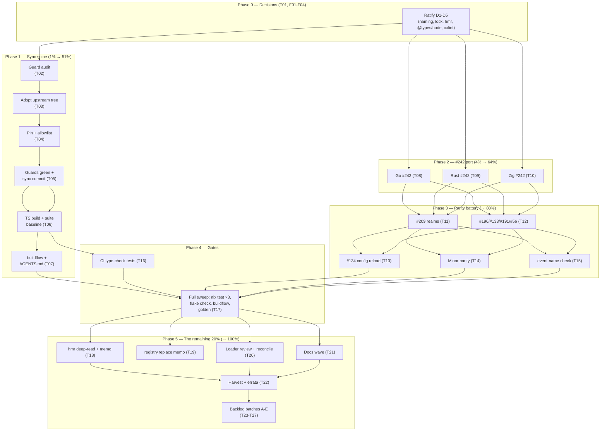

# Pareto Plan: Upstream rc.13 Sync & Port-Parity Program

**Date:** 2026-11-14 16:41 CET
**Author:** planning session following `docs/status/2026-11-14_16-31_upstream-rc10-rc13-assessment.md`
**Inputs:** upstream `main` @ `68c9d99` (rc.13, fetched this session), pin `f8ea3cd` (rc.10), `TODO_LIST.md` (2026-11-14 state), `ROADMAP.md` (Open decisions §208), AGENTS.md gotchas, the 16-31 status report.

**Goal:** absorb the rc.10→rc.13 upstream delta (77 commits, +21.5k lines, 8 new packages, plugin→component rename, tracked yarn.lock, eslint→oxlint) without breaking any guarded surface, and close the port-semantics gaps it exposed (#242 verified; #209/#196/#133/#191/#56/#134 flagged) across the Go/Rust/Zig ports.

**Non-goals (this program):** porting the new upstream packages (fs/http/cli/package-manager) to Go/Rust/Zig; a TypeScript-7 migration; releasing new port tags (separate release-policy decision, ROADMAP).

**Prime constraint:** do not verschlimmbessern. The parity-locked port, byte-guarded fixtures, toolchain pins and two-step build quirk are documented landmines (AGENTS.md); every task below ends with its verification step, and no guard gets weakened to pass.

---

## Errata (Step 0 — corrections to the living backlog)

1. `TODO_LIST.md` → "Upstream tracking: Nothing pending — the pin is `f8ea3cd`" is **stale as of today**: upstream moved to `68c9d99` (rc.13). Superseded by this plan.
2. `TODO_LIST.md` → "rust/deny.toml … still untracked" is stale: `rust/deny.toml` was committed in `f6bf182` (2026-11-14). The devShell cargo-audit/cargo-deny install part of that item still needs verification.
3. **A concurrent session is active in this worktree** (uncommitted `go/loader/entry.go` + new `entry_options.go`/`entry_options_test.go` + the 16-27 buildflow report — not authored by this session). Nothing in this plan may revert or commit those files; T20 explicitly reconciles with them. "One-session-per-worktree" is itself an open ROADMAP decision — worth ratifying (T01 extras).
4. ROADMAP already carries **yarn.lock policy** and **oxlint policy** as open user-gated decisions — the rc.13 delta forces both; they are gates D2/D5 below, not new inventions.

---

## Pareto Breakdown

### The 1% that delivers 51%

**Ratify the three decision gates (D1–D3) and land the mechanical sync commit** (T01–T05: adopt upstream tree, bump pin, repair guards). This single commit re-establishes the fork's core maintenance contract — "packages/ tracks upstream main exactly" — and unblocks every other item. Everything else drifts while the fork sits 77 commits behind a renamed, restructured upstream.

### The 4% that delivers 64% (the 1%, plus)

**Port fix #242 to all three languages** (T08–T10). It is the only _verified_ correctness bug the delta exposed (mid-dispatch listener disposal still fires the listener in Go, Rust and Zig — evidence: `go/events.go:251`, `rust/src/events.rs:289`, `zig/src/cordis.zig:1354`). Small, isolated, testable in every port; kills the one known shared defect.

### The 20% that delivers 80% (the 4%, plus)

- **Parity-test battery for the six flagged core fixes** (#209, #196, #133, #191, #56, #134) across the three ports, fixing what goes red (T11–T14) — converts "flagged by reasoning" into "verified parity or fixed divergence".
- **Post-sync mechanics**: two-step clean build + full TS suite baseline, buildflow/AGENTS.md stale-fact repairs, CI type-check-tests adoption, full local gate sweep (T06–T07, T16–T17). Keeps every gate green that the sync touches.

### The remaining 20% to reach 100%

hmr rework deep-read + re-port decision execution (T18), `registry.replace` evaluation (T19), loader parity review incl. the concurrent session's work (T20), docs wave (T21), backlog harvest (T22), plus the pre-existing TODO_LIST backlog batches (T23–T27: panic-free follow-ups, repo guards, env audits, quality backlog, cross-repo items). None block the 80%; several feed the next upstream cycle.

---

## Decision gates (user-ratified in T01; recommendations stated)

| ID | Decision                                                    | Recommendation (default if silent)                                                        | Why                                                                                                                                                    |
| -- | ----------------------------------------------------------- | ----------------------------------------------------------------------------------------- | ------------------------------------------------------------------------------------------------------------------------------------------------------ |
| D1 | plugin → component rename (#307) in the ports               | **Keep `Plugin` naming**; document divergence in DOMAIN_LANGUAGE/ROADMAP                  | Ports are the fork's product; rename = 3-language API churn, doc churn, golden op renames, zero semantics change. Divergence note is 30 min.           |
| D2 | yarn.lock: adopt upstream's now-tracked lock (#319)         | **Adopt** (byte-parity-guarded, .gitignore un-ignore)                                     | Hermetic installs; kills the "every install re-resolves, one bad bump bricks everyone" failure mode the fork itself documented; upstream now ships it. |
| D3 | Go hmr: re-port onto reworked upstream core (#244/#269)     | **Defer re-port**; keep swap/generation/accept-set model pinned by its watch-golden trace | A re-port is a project (478-line rewrite upstream), not a task; the golden trace pins current semantics; decide after T18's memo.                      |
| D4 | @types/node: keep fork delta `^26.5.0` vs follow `^25.3.5`  | **Keep the delta** (it is the single machine-guarded divergence)                          | The delta is deliberate and guarded; re-evaluate only if upstream's 25.x pin breaks something.                                                         |
| D5 | Oxlint policy for upstream TS (ROADMAP open: "report-only") | **Converge**: upstream now lints with oxlint itself (#326)                                | The fork/upstream split dissolved; keep `yarn lint` as the TS gate, drop the report-only caveat.                                                       |

---

## Comprehensive Plan — Medium granularity (30–100 min each, 27 tasks, ALL todos)

Sorted by importance/impact; effort and customer-value (fork consumers = port users + upstream parity) noted.
(`I`=impact, `E`=effort, H/M/L. Status column feeds TODO_LIST harvest.)

| #   | Task                                                                        | Min | I | E | Value / customer                                   | Status      |
| --- | --------------------------------------------------------------------------- | --- | - | - | -------------------------------------------------- | ----------- |
| T01 | Ratify decision gates D1–D5, record in ROADMAP Open decisions               | 30  | H | S | Unblocks the entire program                        | not started |
| T02 | Pre-sync guard audit (manifest-parity, fixture-canary, parity workflow)     | 45  | H | M | No surprise guard failures post-sync               | not started |
| T03 | Adopt upstream tree: packages/ → `68c9d99` (8 new pkgs, utils gone, lock)   | 100 | H | M | Core fork contract: track upstream exactly         | not started |
| T04 | UPSTREAM_PIN bump + manifest allowlist rewrite + D4                         | 60  | H | M | Machine-guarded divergence stays honest            | not started |
| T05 | Repair parity guards to green; land the sync commit                         | 100 | H | M | CI green; sync reviewable as one commit            | not started |
| T06 | Clean-tree two-step TS build + full TS suite, record new baseline           | 100 | H | M | Working TS workspace on rc.13                      | not started |
| T07 | buildflow eslint-fix rationale → oxlint (D5) + AGENTS.md stale-facts fix    | 60  | H | S | Truthful docs, correct quality gate                | not started |
| T08 | Port #242 to Go (removed flag, 5 dispatch modes, tests)                     | 60  | H | S | Flagship port correctness                          | not started |
| T09 | Port #242 to Rust (+ thread-safe variant tests)                             | 45  | H | S | Rust port correctness                              | not started |
| T10 | Port #242 to Zig                                                            | 45  | H | S | Zig port correctness                               | not started |
| T11 | Parity battery #209 (isolation boundaries, own-provision metadata) ×3 ports | 100 | H | M | Realm semantics = core abstraction correctness     | not started |
| T12 | Parity battery #196/#133/#191/#56 (disposal ordering, settle, isolate move) | 100 | H | M | Lifecycle semantics = core abstraction correctness | not started |
| T13 | #134 config re-resolution on reload/update: decide, implement, test (Go)    | 60  | M | M | hmr/loader correctness upstream changed            | not started |
| T14 | Minor parity batch: #205/#136 error labels, #296 unshift, #206 merge order  | 60  | M | S | API-surface honesty across ports                   | not started |
| T15 | `internal/plugin` event-name stability check post-rename (#307)             | 30  | M | S | Cross-language event contract                      | not started |
| T16 | Adopt #337: type-check tests in fork CI                                     | 45  | M | S | Catches the "vitest never typechecks" class early  | not started |
| T17 | Full local gate sweep: `nix run .#test`, flake check, buildflow, golden     | 60  | H | M | The port gate; proves the program broke nothing    | not started |
| T18 | hmr rework deep-read (#244/#269/#282/#298) + divergence memo + D3 confirm   | 100 | M | M | Informed next-cycle decision, not a guess          | not started |
| T19 | `registry.replace` (#266) evaluation + Go prototype/rejection memo          | 45  | M | M | Feature parity decision, evidence-based            | not started |
| T20 | Loader parity review (#329/#271/#267/#239/#210/#246/#241/#179); reconcile   | 100 | M | M | Go loader stays semantically current               | not started |
|     | with the concurrent session's `entry_options` work                          |     |   |   | (never revert unauthored changes)                  |             |
| T21 | Docs wave: DOMAIN_LANGUAGE, ROADMAP matrix, PORTS.md, README                | 90  | M | M | Fork consumers understand post-rc.13 state         | not started |
| T22 | Harvest this plan + 16-31 report into TODO_LIST/ROADMAP; fix errata         | 45  | M | S | Living docs stay the source of truth               | not started |
| T23 | Backlog batch A: panic-free follow-ups (11 TODO_LIST items)                 | 100 | M | M | Port robustness                                    | not started |
| T24 | Backlog batch B: repo guards, Rust follow-ups, structure splits             | 100 | L | M | Repo health                                        | not started |
| T25 | Backlog batch C: env-audit follow-ups (vulnix re-run, yarn audit, CVE bins) | 60  | L | S | Supply-chain hygiene                               | not started |
| T26 | Backlog batch D: quality items (greeter example, golden v2 ops, misc)       | 100 | L | M | Docs/test depth                                    | not started |
| T27 | Backlog batch E: cross-repo items (upstream build bug, TS7 issue, lessons)  | 100 | L | M | Ecosystem give-back                                | not started |

---

## Detailed Breakdown — Fine granularity (≤ 12 min each, ALL todos)

Micro-task IDs F01–F109; parent in brackets. Sorted by importance inside each workstream.

### Workstream 1 — Decision gates (T01)

| ID  | Micro-task (≤12 min)                                                   | Parent |
| --- | ---------------------------------------------------------------------- | ------ |
| F01 | Write D1 recommendation (keep `Plugin`) with churn inventory           | T01    |
| F02 | Write D2 recommendation (adopt lock) with guard implications           | T01    |
| F03 | Write D3 recommendation (defer hmr re-port, golden-pinned)             | T01    |
| F04 | Record D1–D5 outcomes in ROADMAP Open decisions + ratify worktree rule | T01    |

### Workstream 2 — Pre-sync audit (T02)

| ID  | Micro-task (≤12 min)                                                   | Parent |
| --- | ---------------------------------------------------------------------- | ------ |
| F05 | Read `scripts/manifest-parity.mjs` end-to-end                          | T02    |
| F06 | Read `scripts/hmr-fixture-canary.mjs` end-to-end                       | T02    |
| F07 | Read `upstream-parity` CI workflow job                                 | T02    |
| F08 | Enumerate expected manifest deltas (oxlint/semver/shx/tsx/@types/node) | T02    |
| F09 | Diff fork vs upstream file list (new/deleted/renamed, incl. fixtures)  | T02    |
| F10 | Spot-run prettier@3.9.6 --check on 5 renamed upstream files            | T02    |

### Workstream 3 — The sync commit (T03–T05)

| ID  | Micro-task (≤12 min)                                                  | Parent |
| --- | --------------------------------------------------------------------- | ------ |
| F11 | Adopt upstream packages/ tree at `68c9d99` (checkout-by-path)         | T03    |
| F12 | Take/delete yarn.lock per D2; fix .gitignore                          | T03    |
| F13 | Verify utils gone, 8 new packages present, workspaces `external/*` ok | T03    |
| F14 | Smoke `yarn install` under pinned node/corepack                       | T03    |
| F15 | Confirm yakumo postinstall (yakumo 3.4) runs                          | T03    |
| F16 | Bump `.github/UPSTREAM_PIN` to `68c9d99`                              | T04    |
| F17 | Rewrite manifest allowlist for new devDependency set                  | T04    |
| F18 | Apply D4 (@types/node) and run guard green                            | T04    |
| F19 | Fix fixture-canary literals for renamed `component-*` fixtures        | T05    |
| F20 | Extend/verify byte guard over new+renamed files                       | T05    |
| F21 | Run both guards locally until green                                   | T05    |
| F22 | Land sync commit with detailed message                                | T05    |

### Workstream 4 — TS verification + mechanics (T06–T07)

| ID  | Micro-task (≤12 min)                                               | Parent |
| --- | ------------------------------------------------------------------ | ------ |
| F23 | `trash packages/*/lib` + `tsconfig.tsbuildinfo`                    | T06    |
| F24 | `yarn build core` (two-step quirk, step 1)                         | T06    |
| F25 | `yarn build` (step 2)                                              | T06    |
| F26 | `yarn test` full suite; record new count vs 248                    | T06    |
| F27 | Triage failures (fixtures/toolchain) if any                        | T06    |
| F28 | Rewrite `.buildflow.yml` eslint-fix skip rationale (D5)            | T07    |
| F29 | AGENTS.md: fix yarn.lock fact                                      | T07    |
| F30 | AGENTS.md: eslint→oxlint, pin bump, @types/node, package inventory | T07    |
| F31 | Commit mechanics/docs commit                                       | T07    |

### Workstream 5 — #242 across ports (T08–T10)

| ID  | Micro-task (≤12 min)                                | Parent |
| --- | --------------------------------------------------- | ------ |
| F32 | Go: add `removed` flag to `hook` + splice sets it   | T08    |
| F33 | Go: honor flag in `Emit` + `Parallel`               | T08    |
| F34 | Go: honor flag in `Serial`/`Bail`/`Waterfall`       | T08    |
| F35 | Go: tests — mid-dispatch dispose across all 5 modes | T08    |
| F36 | Go: `go test ./...`, vet, erraudit re-run           | T08    |
| F37 | Rust: `removed` flag (Cell inside `Rc<Hook>`)       | T09    |
| F38 | Rust: all 5 dispatch modes honor flag               | T09    |
| F39 | Rust: tests incl. `thread-safe` variant             | T09    |
| F40 | Rust: `cargo test` + clippy both variants           | T09    |
| F41 | Zig: `removed` field on `Hook`                      | T10    |
| F42 | Zig: both dispatch snapshot loops honor flag        | T10    |
| F43 | Zig: tests; `zig build test` + fmt + docs           | T10    |

### Workstream 6 — Parity battery (T11–T15)

| ID  | Micro-task (≤12 min)                                                  | Parent |
| --- | --------------------------------------------------------------------- | ------ |
| F44 | Port upstream isolate/shadow cases → Go tests (#209)                  | T11    |
| F45 | Same → Rust tests                                                     | T11    |
| F46 | Same → Zig tests                                                      | T11    |
| F47 | Fix Go lookup walk if red (stop at re-isolation)                      | T11    |
| F48 | Fix Rust/Zig if red                                                   | T11    |
| F49 | Own-provision metadata tests ×3 (#209 half 2)                         | T11    |
| F50 | #196 provider-after-dependents tests ×3                               | T12    |
| F51 | #133 settle-DISPOSED tests ×3                                         | T12    |
| F52 | #191 isolate-move unregister tests ×3                                 | T12    |
| F53 | #56 internal/update hooks-with-fiber tests ×3                         | T12    |
| F54 | Fixes for red battery results                                         | T12    |
| F55 | Read #134 diff; decide Go reload semantic                             | T13    |
| F56 | Implement config re-resolution (Go) + tests                           | T13    |
| F57 | #205/#136 error labels ×3 ports                                       | T14    |
| F58 | #296 unshift/prepend parity check ×3                                  | T14    |
| F59 | #206 intercept merge-order tests ×3                                   | T14    |
| F60 | Check upstream `internal/plugin` name survived #307; note in PORTS.md | T15    |

### Workstream 7 — CI + full sweep (T16–T17)

| ID  | Micro-task (≤12 min)                                  | Parent |
| --- | ----------------------------------------------------- | ------ |
| F61 | Add type-check-tests CI step (mirror #337)            | T16    |
| F62 | Verify CI green on push                               | T16    |
| F63 | `nix run .#test-go`                                   | T17    |
| F64 | `nix run .#test-rust`                                 | T17    |
| F65 | `nix run .#test-zig`                                  | T17    |
| F66 | `nix flake check`                                     | T17    |
| F67 | `nix develop -c buildflow`                            | T17    |
| F68 | Golden byte-identity re-verify (4 scenarios ×3 ports) | T17    |

### Workstream 8 — Evaluations (T18–T20)

| ID  | Micro-task (≤12 min)                                                   | Parent |
| --- | ---------------------------------------------------------------------- | ------ |
| F69 | Read #244 (hmr core/fs split) diff                                     | T18    |
| F70 | Read #269 (module graph, per-unit atomicity) diff                      | T18    |
| F71 | Read #282 + #298 diffs                                                 | T18    |
| F72 | Write divergence memo; confirm/update D3                               | T18    |
| F73 | Re-check #264 defaults against Go hmr; update watch-golden if needed   | T18    |
| F74 | Read #266 + replace.spec                                               | T19    |
| F75 | Go `Registry.Replace` prototype or rejection memo                      | T19    |
| F76 | Map loader fixes list onto `go/loader`                                 | T20    |
| F77 | Reconcile with concurrent `entry_options` session (read, never revert) | T20    |
| F78 | Implement applicable loader fixes + tests                              | T20    |
| F79 | Re-run loader watch-golden                                             | T20    |

### Workstream 9 — Docs + harvest (T21–T22)

| ID  | Micro-task (≤12 min)                                                | Parent |
| --- | ------------------------------------------------------------------- | ------ |
| F80 | DOMAIN_LANGUAGE: component rename + drift entries                   | T21    |
| F81 | ROADMAP parity matrix rows (replace, unshift, new pkgs as unported) | T21    |
| F82 | PORTS.md updates (fallibility/event contract notes)                 | T21    |
| F83 | README port table refresh                                           | T21    |
| F84 | Harvest plan+report §f into TODO_LIST/ROADMAP                       | T22    |
| F85 | Fix TODO_LIST errata (deny.toml, upstream-tracking section)         | T22    |
| F86 | Coverage re-baseline numbers into AGENTS.md                         | T22    |
| F87 | Note upstream watch-branches in ROADMAP                             | T22    |

### Workstream 10 — Pre-existing backlog (T23–T27)

| ID   | Micro-task (≤12 min)                                            | Parent |
| ---- | --------------------------------------------------------------- | ------ |
| F88  | Typed-event error-channel design decision (Go+Rust)             | T23    |
| F89  | Zig failure_allocator tests for fallible APIs                   | T23    |
| F90  | Zig dispatch-site comments (15 sites)                           | T23    |
| F91  | Go label-comparability decode-time validation                   | T23    |
| F92  | Rust FiberId encapsulation                                      | T23    |
| F93  | `cargo bench` re-run (arena/Waterfall check)                    | T23    |
| F94  | Miri job in Ports CI                                            | T24    |
| F95  | Rust logger Arg `From` impls (u32/usize)                        | T24    |
| F96  | Verify deny.toml devShell story; workflows job-count review     | T24    |
| F97  | Harvest 2026-09-09_01-54 leftovers                              | T24    |
| F98  | File splits >350 lines only where this program touched them     | T24    |
| F99  | `scripts/vulnix-audit.sh direct` re-run                         | T25    |
| F100 | `yarn npm audit` (TS workspace)                                 | T25    |
| F101 | Bucket jq/perl/libmicrohttpd/zlib CVEs                          | T25    |
| F102 | Greeter example ×3 languages + CI smoke                         | T26    |
| F103 | Logger golden scenario (5th shared run)                         | T26    |
| F104 | Golden v2: snapshot/restore ops in shared DSL                   | T26    |
| F105 | Misc quality: doc cross-links, infertypeargs, nightly seeds     | T26    |
| F106 | Upstream: sandbox root-cause of clean single-step build failure | T27    |
| F107 | Upstream: TS7 minimal reproducer + issue draft                  | T27    |
| F108 | crush-config: oxfmt/strict-JSONC lesson proposal                | T27    |
| F109 | crush-config: fleet `.oxfmtrc.json` proposal                    | T27    |

---

## Execution Graph (mermaid)

**Parallelism:** Phase 2 (port fix) is fully independent of Phase 1 (TS sync) — different trees, no shared files. Phases 1 and 2 can run concurrently in two sessions _only after_ the worktree rule (F04) is ratified; otherwise strictly sequential in one worktree.

---

## Do-no-harm guardrails (anti-verschlimmbesserung)

1. **Never touch the concurrent session's files** (`go/loader/entry.go` mods, `entry_options*.go`, the 16-27 report) — reconcile in T20, never revert.
2. **Never weaken a guard to make it pass** — canary literals, manifest allowlist, byte parity, panic allowlist all get _correct_ updates, not deletions. If a guard cannot be satisfied honestly, stop and report.
3. **Two-step build from a clean tree** before declaring any TS-toolchain change good (AGENTS.md quirk).
4. **Fixtures stay byte-identical to upstream** — never reformat `packages/hmr/tests/**`.
5. **Golden divergence means a port drifted** — fix the port, not the golden file, unless the golden op itself was re-specified upstream.
6. Every phase ends with its named verification task (F21–F22, F36/F40/F43, F68); nothing is "done" unverified.

## Verification summary

- Phase 1 done = guards green + `yarn build`/`yarn test` on rc.13 with recorded baseline.
- Phase 2 done = new mid-dispatch tests green in all three languages, existing suites green.
- Phase 3 done = battery green or divergence documented in ROADMAP.
- Phase 4 done = `nix run .#test` + `nix flake check` + buildflow + golden byte-identity all green.
- Phase 5 done = memos filed, docs updated, TODO_LIST harvested, backlog batches closed or re-queued.

---

_Plan snapshot; the living source of these tasks is `TODO_LIST.md`/`ROADMAP.md` after T22 harvests them._
